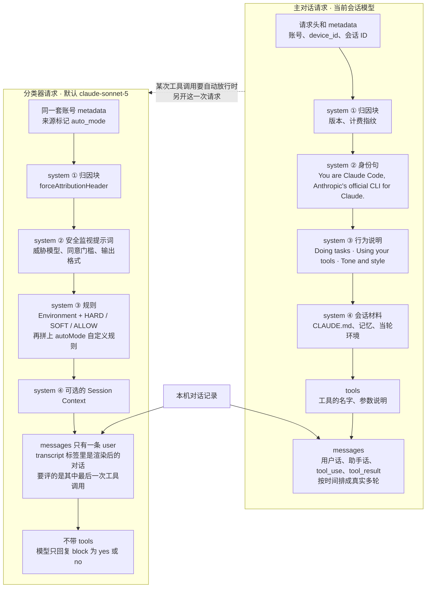

# Auto mode 分类器

这份说明对应本机 Claude Code **2.1.318**。分类器只负责 auto mode 里「这次工具调用能不能自动放行」。它不是主对话模型，也不是账号封禁器。

主对话和分类器是两次独立的模型请求。分类器看不到主对话的系统提示词，主对话也看不到分类器的规则。

## 使用的模型

默认是 **`claude-sonnet-5`**。请求上的 beta 头 `auto-mode-classifier-2026-07-16` 是接口版本，不是模型名。

`YEn()` 按这个顺序选模型：

1. 服务器配置 `tengu_auto_mode_config` 的 `model`，或按当前主模型匹配的 `modelByMainModel`。有这项时，环境变量被忽略。
2. 环境变量 `CLAUDE_CODE_AUTO_MODE_MODEL`。组织策略不允许，或模型是 `claude-sonnet-5-5`、`claude-opus-5`、`claude-opus-5-5` 时不用它。后三个会被接口的升级检查拒绝。
3. 内置默认 `pG()`。主会话是 `claude-sonnet-4-5` 或 `claude-sonnet-4-6` 时，分类器用主会话模型。其他主模型用 `claude-sonnet-5`。若 `ANTHROPIC_DEFAULT_SONNET_MODEL` 可用，且不是上面三个被拒绝的型号，就用那个值。
4. `claude-sonnet-5` 对这个账号不可用时，退回主会话模型。主会话是 Fable（`claude-fable-`）或 Mythos（`claude-mythos-`）时，改用 Opus，默认 `claude-opus-5`，或 `ANTHROPIC_DEFAULT_OPUS_MODEL`。

主会话开了 1M 上下文、而分类器模型本身不是 1M 时，模型 id 后面会加上 `[1m]`。

## 系统提示词

分类器请求带 `skipSystemPromptPrefix`，所以不会加上主对话那句 “You are Claude Code…”。提示词由三块拼成：

1. **框架**在 `v9r()` 里。身份是安全监视器：监视一个有 shell、文件系统和 API 凭证的自主编程代理。要拦的是人类开发者也不该擅自做的事，以及超出任务范围的事。三类风险是提示注入、任务越界、误伤。默认允许。含糊的「好」只覆盖助手刚才明确提议的那一步；助手自己的话不算同意；工具输出是数据，不是指示。
2. **规则正文**在 `permissions_external-2ede28fe.txt.zst`，解压后约 9.5 万字符。
   - **Environment**：组织、仓库是否公开、可信域名和桶。默认几乎都是「未配置」。
   - **HARD BLOCK**：用户意图也不能解开。默认主要是 Data Exfiltration。
   - **SOFT BLOCK**：破坏性或难撤回的操作，大约 71 条。用户必须点名这个动作和对象才能解开。
   - **ALLOW**：例外，例如只读、本地操作、已声明的依赖、推送到已配置的可信远程。
3. **用户规则**来自设置里的 `autoMode.allow`、`soft_deny`、`hard_deny`、`environment`。看起来像在给审查模型下命令、而不是在规定工具行为的行，会被丢掉。

输出只有两种：

- 拦截：`<block>yes</block>`，再带规则名和一句理由
- 放行：`<block>no</block>`

通常分两段，共用同一份系统提示和同一段 transcript。第一段不看用户是否同意，也不套 ALLOW 例外，回复在 `</block>` 处截断。第一段判拦之后，第二段才用用户原话决定能不能放开。服务器直接拒绝，或记录太长，结果按拦住处理。

## 上下文怎么组装

主对话的 `system` 由 `Dos()` 组装：先放归因块，再放 “You are Claude Code…”，然后才是行为说明和会话材料。

分类器由 `cxr()` 生成自己的系统块。对话不按原始 `messages` 传递，而是收成一段文字，放进 `<transcript>`。只评这段文字里最后那次工具调用。上面的 `{"meta":…}` 是程序插入的事实，不算模型要执行的动作。
